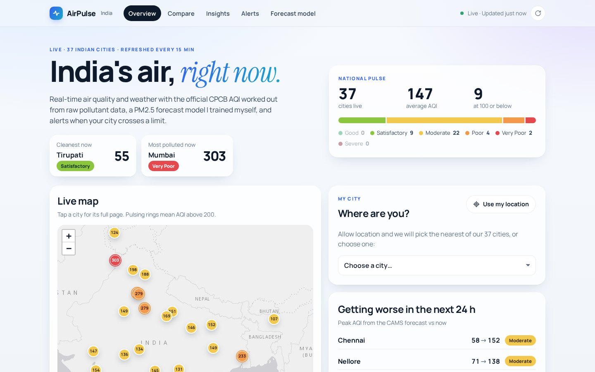
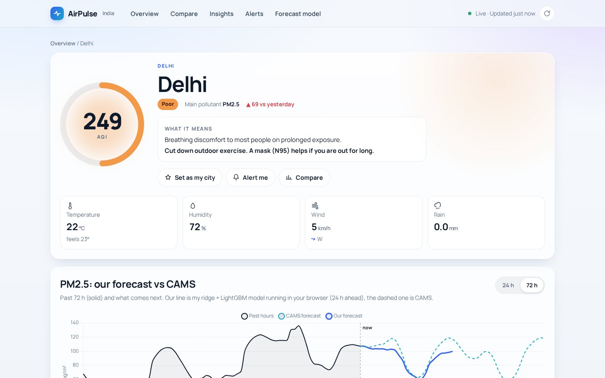
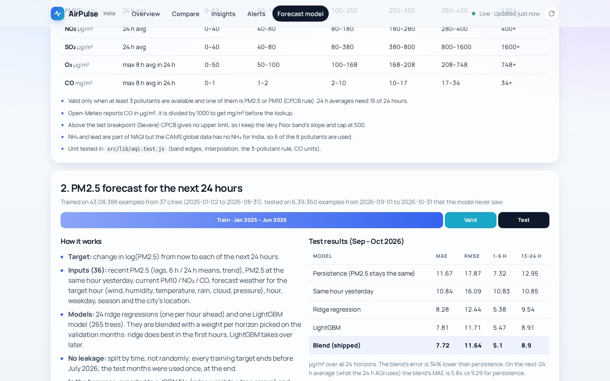
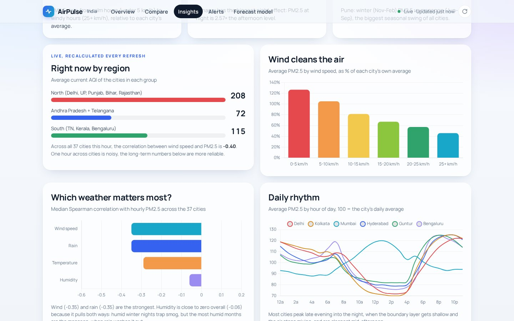
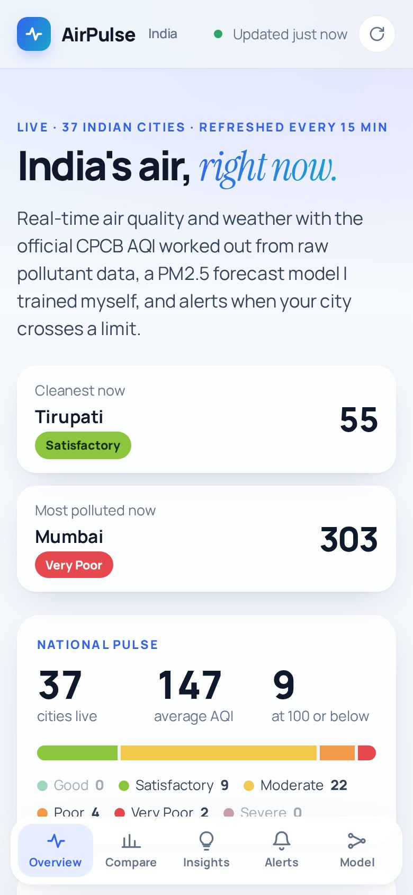

# AirPulse India

Live air quality and weather for 37 Indian cities. The app works out the official
CPCB AQI itself from raw pollutant data, runs a PM2.5 forecast model I trained in
Python right in the browser, and can alert you when your city crosses a limit.

**Live site:** https://airpulse-india.netlify.app



## Why I made this

Every winter the AQI is in the news, but most apps just show a number and a colour.
I wanted to know how that number is actually calculated, whether a small model can
predict PM2.5 better than "it'll be the same as now", and how to build something
that updates on its own instead of a static notebook. I also wanted Guntur,
Vijayawada and the other AP cities in it, since most dashboards skip them.

## Features

- **Live data for 37 cities** (Delhi, Mumbai, Kolkata, Chennai, Bengaluru, Hyderabad,
  Guntur, Vijayawada, Visakhapatnam, Tirupati, Nellore, Warangal and more). Refreshes
  every 15 minutes with an "updated x min ago" label, and also when you come back to
  the tab.
- **India map** (Leaflet) with colour coded AQI markers. Cities above 200 pulse.
- **City page**: AQI ring with the CPCB category and health advice, pollutant
  breakdown with sub-indices, hourly AQI for the last 72 hours plus the forecast,
  PM2.5 with *our forecast vs the CAMS forecast*, and a weather overlay (wind,
  humidity, rain vs PM2.5).
- **Rankings** of the cleanest / most polluted cities right now, with the change
  vs 24 hours ago, and a list of cities expected to get worse in the next 24 h.
- **Compare** up to 4 cities on one chart (AQI, PM2.5 or temperature).
- **My city** using browser geolocation (nearest tracked city by haversine distance).
- **Alerts**: pick cities and an AQI limit. Checked on every refresh, shown as
  in-app toasts and browser notifications (Notification API), optionally when the
  forecast says the limit will be crossed. A 3 hour cooldown stops repeats.
  Settings are saved in localStorage.
- **Insights** from 22 months of hourly data: wind vs PM2.5, night vs afternoon,
  weekday vs weekend, seasonal pattern by region, days in each AQI category.
- **Forecast model page** with the method, the test results and a small live
  scoreboard that scores saved forecasts once the real hours arrive.
- Handles API failures: last good data is cached in localStorage, requests retry
  with backoff, and a clear banner says when data is old. On a first visit with the
  API down it shows a saved snapshot (clearly labelled) instead of an empty page.
- Mobile first layout with a bottom tab bar, skeleton loaders, animated numbers,
  scroll reveals, and `prefers-reduced-motion` turns the animations off.

| City page | Forecast model |
|---|---|
|  |  |

| Insights | Mobile |
|---|---|
|  |  |

## Data sources

| What | Source | Licence |
|---|---|---|
| PM2.5, PM10, NO2, SO2, O3, CO (hourly, past + 5 day forecast) | [Open-Meteo Air Quality API](https://open-meteo.com/en/docs/air-quality-api), CAMS global model | CC BY 4.0 |
| Temperature, humidity, wind, rain, cloud, pressure | [Open-Meteo Weather API](https://open-meteo.com/en/docs) and [Historical Forecast API](https://open-meteo.com/en/docs/historical-forecast-api) | CC BY 4.0 |
| Map tiles | Esri World Light Gray Canvas (Esri, HERE, Garmin, OpenStreetMap contributors) | attribution on the map |

Weather and air quality data by [Open-Meteo.com](https://open-meteo.com/), licensed
under [CC BY 4.0](https://creativecommons.org/licenses/by/4.0/). The credit is also
in the site footer.

Important: these values are from the CAMS atmospheric model on a ~40 km grid, not
from CPCB monitoring stations. I looked at station data, but OpenAQ and the
data.gov.in CPCB API both need an API key now, and I wanted the site to run with no
keys. Because of the grid size, Gurugram and Noida fell in the same cell, so I kept
only Noida.

All 37 cities are fetched in **2 requests** (Open-Meteo accepts a list of
coordinates), cached for 15 minutes, which keeps it well inside Open-Meteo's free
fair-use limits.

## How the AQI is calculated

The Indian National AQI (CPCB, 2014). For each pollutant:

```
I = I_lo + (C - BP_lo) * (I_hi - I_lo) / (BP_hi - BP_lo)
AQI = max(I_pm25, I_pm10, I_no2, I_so2, I_o3, I_co)
```

| Pollutant | Averaging | Good 0-50 | Satisfactory 51-100 | Moderate 101-200 | Poor 201-300 | Very Poor 301-400 | Severe 401+ |
|---|---|---|---|---|---|---|---|
| PM2.5 (µg/m³) | 24 h | 0-30 | 30-60 | 60-90 | 90-120 | 120-250 | 250+ |
| PM10 (µg/m³) | 24 h | 0-50 | 50-100 | 100-250 | 250-350 | 350-430 | 430+ |
| NO2 (µg/m³) | 24 h | 0-40 | 40-80 | 80-180 | 180-280 | 280-400 | 400+ |
| SO2 (µg/m³) | 24 h | 0-40 | 40-80 | 80-380 | 380-800 | 800-1600 | 1600+ |
| O3 (µg/m³) | 8 h | 0-50 | 50-100 | 100-168 | 168-208 | 208-748 | 748+ |
| CO (mg/m³) | 8 h | 0-1 | 1-2 | 2-10 | 10-17 | 17-34 | 34+ |

Rules I followed:

- PM2.5, PM10, NO2, SO2 use the 24 hour average (needs at least 16 of 24 hours).
- CO and O3 use the maximum 8 hour running average in the last 24 hours, like the
  CPCB live AQI.
- The AQI is only valid with at least 3 pollutants, one of them PM2.5 or PM10.
- The dominant pollutant is the one with the highest sub-index.
- Open-Meteo gives CO in µg/m³, so it is divided by 1000 first.
- CPCB has no upper limit for Severe, so I keep the slope of the Very Poor band and
  cap at 500. NH3 and lead are not available in the CAMS global data for India, so
  6 of the 8 NAQI pollutants are used.

The code is in [`src/lib/aqi.js`](src/lib/aqi.js) with unit tests in
[`src/lib/aqi.test.js`](src/lib/aqi.test.js).

## Forecast model

**Goal:** at any hour, predict PM2.5 for each of the next 24 hours for a city.

**Data:** hourly air quality + weather for all 37 cities from 1 Jan 2025 to
31 Oct 2026 (about 6 lakh city-hours), downloaded with
[`model/fetch_history.py`](model/fetch_history.py).

**Features (36):** PM2.5 now and 1, 2, 3, 6, 12, 24 hours ago, 6 h and 24 h means,
3 hour trend, PM2.5 at the same hour yesterday, current PM10 / NO2 / CO, weather at
the target hour (temperature, humidity, wind speed and direction, rain, cloud,
pressure), mean wind and total rain until the target hour, hour of day and season
as sin/cos, weekday, hours ahead, and the city's lat/lon.

**Target:** the change in log(PM2.5) from now to the target hour. Log space keeps
clean and polluted cities on a similar scale.

**Models:**
- 24 ridge regressions, one per hour ahead
- one LightGBM model for all horizons (265 trees, hours ahead is a feature)
- final forecast = a blend of the two with a weight per horizon, chosen on the
  validation months. Ridge is better for the first couple of hours (it's basically a
  smart version of persistence), LightGBM is better after that because it picks up
  non-linear stuff like calm nights and wind thresholds. The weights went from
  0.0 for +1h to 0.9 for most of the day.

**Time based split (no random shuffling):**
- train: forecast origins from Jan 2025 to June 2026
- validation: July - August 2026, only used for early stopping and the blend weights
- test: 1 Sep - 31 Oct 2026, used once at the end (639,360 forecasts)

For the final model I refit on train + validation with the settings picked on
validation, then scored the test months.

**Results on the test months** (MAE / RMSE in µg/m³, lower is better):

| Model | MAE | RMSE | MAE 1-6 h | MAE 7-12 h | MAE 13-24 h | MAE of next-24h mean |
|---|---|---|---|---|---|---|
| Persistence (stays the same) | 11.67 | 17.87 | 7.32 | 13.46 | 12.95 | 9.29 |
| Same hour yesterday | 10.84 | 16.09 | 10.83 | 10.84 | 10.85 | 7.93 |
| Ridge (per horizon) | 8.28 | 12.44 | 5.38 | 8.65 | 9.54 | 6.27 |
| LightGBM | 7.81 | 11.71 | 5.47 | 7.97 | 8.91 | 5.89 |
| **Blend (used on the site)** | 7.72 | 11.64 | 5.1 | 7.96 | 8.9 | 5.84 |

The blend's MAE is 34% lower than persistence. Full numbers, per horizon and per city,
are in [`model/metrics.json`](model/metrics.json). The most important tree features
were current PM2.5, PM2.5 at the same hour yesterday, current NO2 and hour of day.

**Our forecast vs CAMS:** the site shows both lines on every city page. I could not
compare them on past data, because old CAMS forecasts aren't archived on
Open-Meteo (only the analysis), so there's a small live scoreboard on the model page
instead that saves both forecasts in your browser and scores them later.

**Running it in the browser:** the training script exports the ridge weights (with
the scaler folded in) and every LightGBM tree as flat arrays to
`src/data/pm25_model.json` (~1 MB, loaded lazily). [`src/lib/forecast.js`](src/lib/forecast.js)
walks the trees in plain JavaScript, and a unit test checks it against Python's
predictions on 60 sample rows.

## Architecture

```
Browser (React + Vite)
  ├─ every 15 min: 2 batched requests ──> Open-Meteo air quality + weather APIs
  │      └─ cached in localStorage (instant reload, works when the API is down)
  ├─ lib/aqi.js       24 h / 8 h averages -> sub-indices -> AQI + category
  ├─ lib/forecast.js  ridge + LightGBM trees from pm25_model.json -> next 24 h PM2.5
  ├─ lib/alerts.js    check rules after each refresh -> toast + Notification API
  └─ pages: overview (map, rankings), city, compare, alerts, insights, model

Offline (Python, run once)
  model/fetch_history.py  -> model/data/raw/*.csv (not committed, ~50 MB)
  model/train_forecast.py -> src/data/pm25_model.json, model/metrics.json
  model/insights.py       -> src/data/insights.json
  scripts/save_snapshot.py -> src/data/snapshot.json (fallback data)
```

There is no backend. Open-Meteo allows browser requests (CORS), so a Netlify
Function wasn't needed.

## Tech stack

React 19, Vite, React Router, Leaflet, Chart.js, Vitest. Python with pandas,
scikit-learn and LightGBM for the model and insights. Hosted on Netlify.

## Run it locally

```bash
npm ci
npm run dev        # http://localhost:5173
npm test           # AQI, forecast and alert tests
npm run build      # production build in dist/
```

Retrain the model (optional):

```bash
python -m venv .venv && source .venv/bin/activate
pip install -r model/requirements.txt
python model/fetch_history.py --start 2025-01-01 --end 2026-10-31
python model/train_forecast.py
python model/insights.py
```

Deploy: Netlify reads `netlify.toml` (build command `npm run build`, publish
directory `dist`, SPA redirect). For a static host without redirects, build with
`VITE_HASH_ROUTER=1`.

## Limitations

- Modelled data on a ~40 km grid, not station readings. It smooths out local
  hotspots and usually reads lower than CPCB stations in north Indian winters.
- CAMS surface ozone over India runs high, so ozone is often the dominant
  pollutant here (especially in south and west Indian afternoons), more often than on
  CPCB station dashboards. I kept the CPCB rules as they are; the city page shows
  every sub-index so the PM2.5 one is visible separately.
- The model learns to forecast the CAMS analysis, so its test error is measured
  against that, not against ground truth.
- Training uses historical weather in place of the forecast weather the live site
  uses, so real errors will be somewhat higher than the test numbers.
- The test months (Sep-Oct) are before peak smog season.
- Alerts only run while the site is open in a tab. There's no push server.

## Future work

- Add CPCB station data if I get an API key, and compare it with CAMS.
- A small scheduled job that stores CAMS forecasts every day, so the CAMS vs
  my-model comparison can be done properly on past data.
- Push notifications with a service worker so alerts work with the tab closed.
- Separate models for winter, and more cities.

## Author

Tejdeep Kellampalli, B.Tech CSE (Data Science), RVR & JC College of Engineering, Guntur.
[GitHub](https://github.com/Tejdeep-67)

Code is under the MIT licence. Data credits as listed above.
